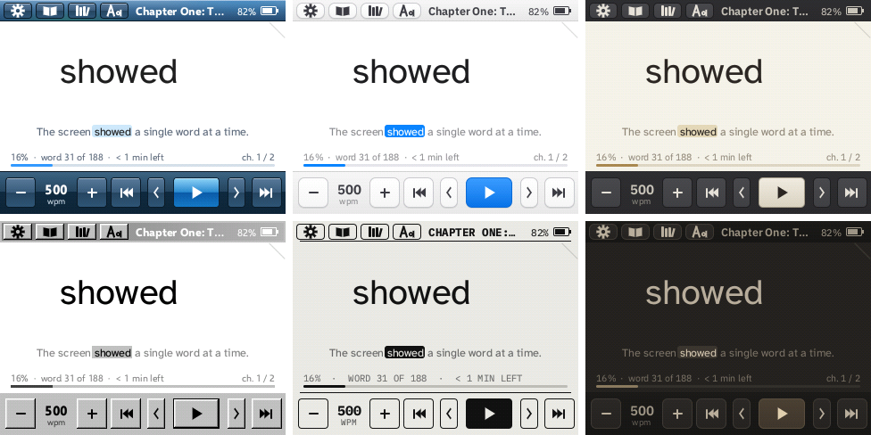

# Fast Reader

A speed reader (RSVP) for a 2.8" ESP32-S3 touch display, written in Rust:
one word, phrase or page at a time, books and pictures on an SD card, and a
phone page to read along, change settings and add books over Wi-Fi.




*Shakespeare's Sonnet 18 at 350 words a minute in the Windows 98 theme: near the end it pauses, jumps one sentence back, steps two words forward, bookmarks that word (the folded corner), and reads on to the end. Recorded from the simulator (`reader-sim record … --demo`).*

- **Four ways to read:** word by word, phrases (up to 3 words, ending at sentences), a typewriter ticker, and normal pages.
- **Placed by the book, not the screen:** words centred or on a fixed recognition point (Spritz rule, long words split at a syllable); bold, italic and chapter titles kept; brackets read as asides.
- **Real books:** EPUB, PDF (scanned ones too), Markdown; pictures with their captions, shown for a set time; bookmarks as a folded page corner.
- **Lists, tables and figures:** list markers down the side with the current one lit; tables read cell by cell with the whole table below the word; "see figure 11" shows figure 11 below the word.
- **Looks after you:** a welcome back card after a break, a sleep timer, and a warning when the SD card is taken out.
- **A phone page:** join the reader's Wi-Fi, the book opens in the browser, follows your place, changes every setting, converts and sends new books.
- **Four themes:** Windows 98, Vista, Scrivener, Night; optional colourful menu buttons.
- **On a Mac or in a browser:** the same reader as an app ([download](https://github.com/aallevi/fastreader/releases/latest)) or compiled to WebAssembly (`docs/demo`).

## The code, by size

```
┌──────────────────────────────────────┬──────────────────────────────────┐
│ reader-core  38%   logic, no_std     │ reader-ui  30%   drawing, no_std │
│ ┌─────────────────┬────────────────┐ │ ┌───────────────┬──────────────┐ │
│ │ app.rs          │ book.rs        │ │ │ painter.rs    │ layout.rs    │ │
│ │ keys → actions, │ markup, pacing,│ │ │ every screen, │ buttons and  │ │
│ │ menus, feedback │ brackets, pics │ │ │ redraw boxes  │ touch areas  │ │
│ ├──────────┬──────┴─────┬──────────┤ │ ├───────────────┼──────────────┤ │
│ │ reader.rs│ settings.rs│ gestures │ │ │ web.rs        │ canvas, text │ │
│ │ timing   │ by name    │ chunked  │ │ │ phone server  │ themes, icons│ │
│ └──────────┴────────────┴──────────┘ │ └───────────────┴──────────────┘ │
├───────────────────┬──────────┬───────┴──┬───────────┬───────────────────┤
│ firmware  12%     │ sim  6%  │ tools 6% │ web  6%   │ fat-format  2%    │
│ ESP32-S3: display,│ desktop  │ convert, │ the phone │ formats the SD    │
│ touch, SD, Wi-Fi  │ + tests  │ OCR→EPUB │ page      │ card as FAT32     │
└───────────────────┴──────────┴──────────┴───────────┴───────────────────┘
```

Everything that decides what you see is in the two `no_std` crates, tested on
the desktop (187 tests, including randomized stress runs and a book with lists, tables, pictures and figure references played through every theme and mode); the firmware only
moves pixels, touches and bytes.

## Controls

| On screen | Key | Reading | Page view |
|---|---|---|---|
| ⚙ 📖 📚 Aa | BOOT long | Settings · Book · Library · Text | same |
| − / + | ▼ / ▲ | speed ∓25 wpm | same |
| ⏮ / ⏭ | ◀ / ▶ | back / forward a sentence · hold: scroll | previous / next page |
| ‹ / › | – | one word, and pause | same |
| ▶ | BOOT short | play / pause | same |
| page corner | – | bookmark | same |

## Pictures, lists and tables, while you read

RSVP readers are built around the words. The ones we could check (App Store
speed readers, browser and Obsidian plugins, November 2026) drop pictures,
lists and tables or turn them into plain words; the closest, an Obsidian
plugin, reads a table cell by cell with a pause at the end of each row. None
we found shows a figure when the text points to it. Here they stay part of
the reading:

- **Pictures** come in the word stream, shown for a set time (or until ▶);
  their description shows when paused.
- **Figure references:** at "see figure 11" the figure itself appears below
  the word (numbers learnt from the captions when the book opens).
- **Lists:** the bullets or numbers run down the side, the current item lit,
  a breath between items; a picture inside a list keeps the markers beside
  it, and catalogues (picture, then "1. title") pair each picture with its
  item.
- **Tables:** the whole table below the word with the cell being read lit
  (or its grid flashed before each cell), at half speed with a breath before
  each column; a table counts as one sentence for ⏮ ⏭ and a cell as one word
  for ‹ ›.
- **From real books:** EPUB lists and tables convert as such; on the Mac the
  converter also finds tables and symbol-font bullets in PDFs.

## Try it on a Mac

Download `FastReader-<version>.dmg`, open it and drag **Fast Reader** onto
Applications. It is the same reader as the device, in a window you can
resize (or fill the screen); add books from its page at
http://localhost:8080 (Settings > Add a book) and they stay, with your
place, in ~/Library/Application Support/FastReader. The app isn't signed
with an Apple Developer ID yet: the first time, right-click it > Open (or
System Settings > Privacy & Security > Open Anyway).

`packaging/make_dmg.sh` builds the disk image (Apple silicon + Intel);
`packaging/release.sh <version> <notes.md>` makes a whole release: tests,
the Mac app and the reader's firmware image (`fastreader-es3c28p-<version>.bin`,
written at 0x0: `espflash write-bin 0 fastreader-es3c28p-<version>.bin`).

## Run it

```sh
cargo test --workspace                                   # logic, drawing, web, stress
tools/build_demo.sh                                      # the reader in a web page (WebAssembly): docs/demo
cargo run -p reader-sim --release                        # desktop window (sharp, resizable: fills any size) + web page on :8080
cargo run -p reader-sim --release -- --device            # the reader's real 320x240 pixels
cargo run -p reader-sim --release -- --lan               # let a phone on the same Wi-Fi open :8080 (allow it in the macOS firewall)
cargo run -p reader-sim --release -- walkthrough out/    # a PNG of every screen and theme

. ~/export-esp.sh && cd firmware                         # the device (espup, espflash)
cargo run --release
```

Books: `tools/convert.py book.epub scan.pdf --sd /Volumes/FASTREADER` writes
them straight to the card; `tools/ocr_book.py scan.pdf book.epub` turns a
scanned PDF into a real EPUB (LightOnOCR-2, text plus every illustration).
Or add them from the phone page.

## Hardware

LCDWIKI **ES3C28P**: ESP32-S3 with 8 MB PSRAM, 2.8" 320×240 IPS (ILI9341V),
FT6336 touch, microSD slot (FAT32; the reader formats it), Li-ion charging.
Optional buttons on GPIO 2, 3, 14, 21 to GND.

## More

[VERIFY.md](VERIFY.md) on-device checklist · [AUDIT.md](AUDIT.md) how
everything was checked · [PLAN.md](PLAN.md) what's next

Inspired by [AllanBinder/ereader](https://github.com/AllanBinder/ereader);
built on esp-rs, Embassy, pdf.js and more, and on reading research from
McConkie & Rayner to Rayner et al. (2016): see **[CREDITS.md](CREDITS.md)**
for credits and bibliography. Code MIT ([LICENSE](LICENSE)); fonts SIL OFL 1.1 ([assets/fonts](assets/fonts/LICENSE.md));
pdf.js Apache-2.0 ([assets/web](assets/web)).
