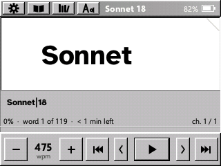

# Fast Reader

A speed reader (RSVP) for a 2.8" ESP32-S3 touch display, written in Rust:
one word, phrase or page at a time, books and pictures on an SD card, and a
phone page to read along, change settings and add books over Wi-Fi.




*Shakespeare's Sonnet 18 at 350 words a minute in the Windows 98 theme: near the end it pauses, jumps one sentence back, steps two words forward, bookmarks that word (the folded corner), and reads on to the end. Recorded from the simulator (`reader-sim record … --demo`).*

- **Four ways to read:** word by word, phrases (up to 3 words, ending at sentences), a typewriter ticker, and normal pages.
- **Placed by the book, not the screen:** words centred or on a fixed recognition point (Spritz rule, long words split at a syllable); bold, italic and chapter titles kept; brackets read as asides.
- **Real books:** EPUB, PDF (scanned ones too), Markdown; pictures with their captions, shown for a set time; bookmarks as a folded page corner.
- **A phone page:** join the reader's Wi-Fi, the book opens in the browser, follows your place, changes every setting, converts and sends new books.
- **Four themes:** Windows 98, Vista, Scrivener, Night.

## The code, by size

```
┌──────────────────────────────────────┬──────────────────────────────────┐
│ reader-core  38%   logic, no_std     │ reader-ui  30%   drawing, no_std │
│ ┌─────────────────┬────────────────┐ │ ┌───────────────┬──────────────┐ │
│ │ app.rs          │ book.rs        │ │ │ painter.rs    │ layout.rs    │ │
│ │ keys → actions, │ markup, pacing,│ │ │ every screen, │ buttons and  │ │
│ │ menus, feedback │ brackets, pics │ │ │ redraw boxes  │ touch areas  │ │
│ ├──────────┬──────┴─────┬──────────┤ │ ├───────────────┼──────────────┤ │
│ │ reader.rs│ settings.rs│ gestures │ │ │ web.rs        │ canvas, text │ │
│ │ timing   │ by name    │ chunked  │ │ │ phone server  │ themes, icons│ │
│ └──────────┴────────────┴──────────┘ │ └───────────────┴──────────────┘ │
├───────────────────┬──────────┬───────┴──┬───────────┬───────────────────┤
│ firmware  12%     │ sim  6%  │ tools 6% │ web  6%   │ fat-format  2%    │
│ ESP32-S3: display,│ desktop  │ convert, │ the phone │ formats the SD    │
│ touch, SD, Wi-Fi  │ + tests  │ OCR→EPUB │ page      │ card as FAT32     │
└───────────────────┴──────────┴──────────┴───────────┴───────────────────┘
```

Everything that decides what you see is in the two `no_std` crates, tested on
the desktop (155 tests, including randomized stress runs); the firmware only
moves pixels, touches and bytes.

## Controls

| On screen | Key | Reading | Page view |
|---|---|---|---|
| ⚙ 📖 📚 Aa | BOOT long | Settings · Book · Library · Text | same |
| − / + | ▼ / ▲ | speed ∓25 wpm | same |
| ⏮ / ⏭ | ◀ / ▶ | back / forward a sentence · hold: scroll | previous / next page |
| ‹ / › | – | one word, and pause | same |
| ▶ | BOOT short | play / pause | same |
| page corner | – | bookmark | same |

## Run it

```sh
cargo test --workspace                                   # logic, drawing, web, stress
cargo run -p reader-sim --release                        # desktop window (sharp, 960x720) + web page on :8080
cargo run -p reader-sim --release -- --device            # the reader's real 320x240 pixels
cargo run -p reader-sim --release -- --lan               # let a phone on the same Wi-Fi open :8080 (allow it in the macOS firewall)
cargo run -p reader-sim --release -- walkthrough out/    # a PNG of every screen and theme

. ~/export-esp.sh && cd firmware                         # the device (espup, espflash)
cargo run --release
```

Books: `tools/convert.py book.epub scan.pdf --sd /Volumes/FASTREADER` writes
them straight to the card; `tools/ocr_book.py scan.pdf book.epub` turns a
scanned PDF into a real EPUB (LightOnOCR-2, text plus every illustration).
Or add them from the phone page.

## Hardware

LCDWIKI **ES3C28P**: ESP32-S3 with 8 MB PSRAM, 2.8" 320×240 IPS (ILI9341V),
FT6336 touch, microSD slot (FAT32; the reader formats it), Li-ion charging.
Optional buttons on GPIO 2, 3, 14, 21 to GND.

## More

[VERIFY.md](VERIFY.md) on-device checklist · [AUDIT.md](AUDIT.md) how
everything was checked · [PLAN.md](PLAN.md) what's next

Inspired by [AllanBinder/ereader](https://github.com/AllanBinder/ereader);
built on esp-rs, Embassy, pdf.js and more, and on reading research from
McConkie & Rayner to Rayner et al. (2016): see **[CREDITS.md](CREDITS.md)**
for credits and bibliography. Code MIT ([LICENSE](LICENSE)); fonts SIL OFL 1.1 ([assets/fonts](assets/fonts/LICENSE.md));
pdf.js Apache-2.0 ([assets/web](assets/web)).
